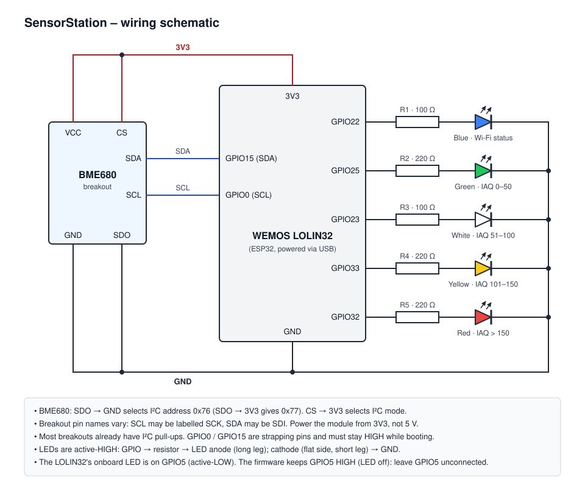

# SensorStation – ESP32 + Bosch BME680 Indoor Air Quality Monitor

An ESP32 firmware (PlatformIO / Arduino framework) that reads a **Bosch BME680** environmental sensor through the
**Bosch BSEC** library and does three things with the readings:

- computes an **Indoor Air Quality (IAQ)** index plus temperature and humidity,
- shows the current air quality on a set of **status LEDs** (green / white / yellow / red),
- sends a reading once a minute to the **Persoboard ingest server** (the backend of the Persoboard dashboard) over
  **HTTPS with mutual TLS**, each request signed with **HMAC-SHA256**.

Wi-Fi credentials are not hard-coded. On first boot the device opens a **WiFiManager** captive portal where you
pick the network and the ingest server.

The device-to-server contract (request format, signing, response codes, acceptance tests) is in
[docs/esp32-firmware.md](docs/esp32-firmware.md).

---

## Table of contents

- [Features](#features)
- [Hardware](#hardware)
- [Wiring](#wiring)
- [LED indicators](#led-indicators)
- [Software and dependencies](#software-and-dependencies)
- [Configuration](#configuration)
- [Persoboard ingest server](#persoboard-ingest-server)
- [Build and flash](#build-and-flash)
- [First boot and Wi-Fi setup](#first-boot-and-wi-fi-setup)
- [How it works](#how-it-works)
- [Project structure](#project-structure)
- [Troubleshooting](#troubleshooting)
- [Known limitations / notes](#known-limitations--notes)
- [License](#license)

---

## Features

- **BSEC-based IAQ**: IAQ index with accuracy (0–3), plus heat-compensated temperature and humidity
  with a configurable temperature offset for self-heating.
- **Persistent calibration**: the BSEC calibration state is saved to flash when the IAQ accuracy improves, every 6 h
  once fully calibrated, and before any self-restart. It is restored on boot.
- **Status LEDs**: one LED shows Wi-Fi status and four LEDs show the air-quality level.
- **Captive-portal Wi-Fi setup** through [WiFiManager](https://github.com/tzapu/WiFiManager). It opens
  automatically when the saved network can't be reached, or on demand by **pressing RST twice within 3 seconds**.
  It closes after 3 minutes so the device never gets stuck in setup mode.
- **Secure upload**: mutual TLS that trusts only the Persoboard CA and checks the server's host name, plus an
  HMAC-SHA256 signature with a timestamp and a random nonce on every request. The signing code checks itself against
  the contract's test vector at every boot.
- **No lost readings**: unsent readings wait in a 180-entry ring buffer (3 hours) that also survives software
  restarts, and are delivered oldest first with their original timestamps once the server is back.
- **Never blocks the sensor**: sending runs in its own task, so BSEC keeps its 3 s sample rate while the network is
  slow or down.
- **NTP time**: readings carry the time they were taken, from NTP (synced at start, every hour, and after a
  rejected request).
- **Self-healing connectivity**: Wi-Fi reconnect with periodic retries, retry with exponential backoff, a reboot after
  15 minutes without Wi-Fi or 1 hour without any answer from the server, and a task watchdog for hangs.
- **Configurable without re-flashing**: the ingest server's host name and port are set in the Wi-Fi portal.

---

## Hardware

| Component | Notes |
|---|---|
| **ESP32 board** | **WEMOS LOLIN32** (`board = lolin32`). Other ESP32 dev boards work too if you change `board` in `platformio.ini` and check the pins. |
| **Bosch BME680 breakout** | I²C mode, address **`0x76`** (set to `0x77` if your board's SDO pin is pulled high). |
| **5 × LEDs** | Blue, green, white, yellow, red (3 mm or 5 mm). |
| **5 × resistors** | 220 Ω for green, yellow and red; 100 Ω for blue and white (see the note below). |
| Power | USB 5 V to the ESP32 board. Power the BME680 from **3.3 V**. |
| Ingest server | The Persoboard ingest server: on a PC in the LAN (port 8443) or on OpenShift (port 443). |

> **Resistor values:** the GPIOs drive 3.3 V. Red, yellow and green LEDs drop about 2 V, so 220 Ω gives roughly
> 5–6 mA. Blue and white LEDs drop about 2.8–3.1 V, which leaves very little headroom at 3.3 V; with 220 Ω they would
> be barely visible, so they get 100 Ω. If an LED is too bright or too dim, adjust its resistor.

---

## Wiring



All pins are defined at the top of [src/main.cpp](src/main.cpp). The schematic source is
[docs/schematic.svg](docs/schematic.svg).

### BME680 (I²C)

| BME680 pin | Connect to | Notes |
|---|---|---|
| VCC / VIN | ESP32 **3V3** | Not 5 V |
| GND | ESP32 **GND** | |
| SDA (sometimes labelled SDI) | **GPIO 15** | |
| SCL (sometimes labelled SCK) | **GPIO 0** | |
| SDO | **GND** | Selects address `0x76` (tie to 3V3 for `0x77`) |
| CS | **3V3** | Selects I²C mode (often already done on the breakout) |

> ⚠️ GPIO 0 and GPIO 15 are ESP32 **strapping pins**. The I²C pull-up resistors on the breakout keep them high, which
> is the normal boot state, so this works. Still, nothing should pull these lines low while the board resets. If you
> run into boot problems, move I²C to the ESP32 defaults (SDA 21 / SCL 22). GPIO 22 is currently taken by the blue
> LED, so you would need to move that LED too.

### LEDs

Every LED is wired the same way: **GPIO → resistor → LED anode (long leg)**, and **LED cathode (short leg, flat
side) → GND**. They are active-HIGH.

| LED | ESP32 GPIO | Resistor | Meaning |
|---|---|---|---|
| Blue | **GPIO 22** | 100 Ω | Wi-Fi status |
| Green | **GPIO 5** | 220 Ω | IAQ 0–50 |
| White | **GPIO 23** | 100 Ω | IAQ 51–100 |
| Yellow | **GPIO 33** | 220 Ω | IAQ 101–150 |
| Red | **GPIO 32** | 220 Ω | IAQ > 150 |

> The LOLIN32's **onboard LED is also on GPIO 5** but is active-LOW, so it is lit whenever the green LED is off.
> This is expected.

---

## LED indicators

### Startup

| LED state | Meaning |
|---|---|
| Green, white, yellow and red **on**, blue off (first 3 s) | Double-reset window: press RST again now to open the configuration portal |
| Green, white, yellow and red **on**, blue **blinking** | Connecting to the saved Wi-Fi (up to 3 × 30 s) |
| Blue **solid on**, all others off | The **configuration portal** is open: either RST was pressed twice, or the saved Wi-Fi isn't reachable (or none is saved) |
| All LEDs **off** | Startup finished; waiting for the first IAQ result |

### Normal operation

| LED state | Meaning |
|---|---|
| Blue **blinking** (0.5 s) | Wi-Fi lost; reconnecting |
| Blue **off** | Wi-Fi connected |
| One of green / white / yellow / red on | Current air-quality level (see below) |

The IAQ LED updates with each reading (once a minute), not on every sample. It shows the same IAQ value that is
sent to the server.

### IAQ colour scale

The thresholds follow the Bosch BSEC IAQ scale:

| IAQ index | Bosch classification | LED |
|---|---|---|
| 0 – 50 | Excellent | 🟢 Green |
| 51 – 100 | Good | ⚪ White |
| 101 – 150 | Lightly polluted | 🟡 Yellow |
| 151 – 500 | Moderately to extremely polluted | 🔴 Red |

---

## Software and dependencies

- [PlatformIO](https://platformio.org/) (VS Code extension `platformio.platformio-ide` recommended)
- Platform: `espressif32 @ ^6.12.0` (Arduino-ESP32 core 2.0.x), framework: `arduino`

Libraries (PlatformIO downloads them automatically from `lib_deps`):

| Library | Version | Purpose |
|---|---|---|
| [`boschsensortec/BSEC Software Library`](https://github.com/boschsensortec/BSEC-Arduino-library) | `^1.8.1492` | BME680 driver + BSEC IAQ algorithm (includes a precompiled `libalgobsec.a` for ESP32) |
| [`tzapu/WiFiManager`](https://github.com/tzapu/WiFiManager) | latest from GitHub | Wi-Fi captive portal |

HTTPS, TLS and the SHA-256 / HMAC code come with the Arduino-ESP32 core (`HTTPClient`, `WiFiClientSecure`, mbedTLS).

The platform is pinned to the 6.x line because the task-watchdog call (`esp_task_wdt_init(timeout, panic)`) uses the
core 2.x API. Core 3.x changed that signature.

---

## Configuration

### 1. Device credentials: `secrets.h` (required, not in git)

Each device has its own credentials, generated on the Persoboard side:

```powershell
python scripts/pki.py device bedroom-esp32
```

Copy the resulting `certs/devices/bedroom-esp32/secrets.h` into this repository at the **same path**
(`certs/devices/<device-id>/secrets.h`), and set the device id in [platformio.ini](platformio.ini):

```ini
custom_pb_device = bedroom-esp32
```

The build adds `certs/devices/<custom_pb_device>/` to the include path. The firmware doesn't build without the file,
and `flash.ps1` checks for it first.

| Symbol | What it is |
|---|---|
| `PB_DEVICE_ID` | Device id, sent in the `X-PB-Device` header |
| `PB_HMAC_KEY_HEX` | 32-byte signing key (64 hex characters) |
| `PB_CA_CERT` | Persoboard CA certificate: the **only** CA the device trusts |
| `PB_CLIENT_CERT` / `PB_CLIENT_KEY` | This device's certificate and private key (ECDSA P-256), for mutual TLS |

- **It's a secret.** `certs/` and every `secrets.h` are git-ignored. Never commit, log or print any part of it; the
  firmware doesn't either.
- **One `secrets.h` per physical device.** For a second station, generate new credentials, copy them to
  `certs/devices/<other-id>/` and build with `custom_pb_device` set to that id.
- After a credential rotation (`scripts/pki.py device <id> --rotate`), replace the file and re-flash. A revoked device
  just gets `401` for every request.

### 2. Local settings: `inc/config.hpp` (optional, not in git)

`inc/config.hpp` is **ignored by git** (`**/config.hpp` in `.gitignore`). It holds the **portal password** and,
optionally, the **default** ingest server, which is used until another one is saved in the portal:

```cpp
// inc/config.hpp
#pragma once

#define PORTAL_PASSWORD "at-least-8-characters"     // WPA2 password of the ESP_SensorKit setup network

// optional defaults; can be changed in the portal
#define INGEST_DEFAULT_HOST "192.168.0.27"
#define INGEST_DEFAULT_PORT 8443
#define INGEST_DEFAULT_CERT_NAME "localhost"        // needed when the host is an IP address
```

- **`PORTAL_PASSWORD` is strongly recommended.** Without it, `ESP_SensorKit` is an **open** network, so anyone nearby
  could use the portal while it's open and point the device at another server (TLS would still refuse a server
  without a Persoboard certificate). The build prints a warning if it's missing. WPA2 requires 8–63 characters, and
  the build fails otherwise.
- Without `config.hpp` the firmware still builds. The ingest server is then empty, and the portal opens at boot until
  one is set.

### 3. Settings in the source

**Hardware and network** (`src/main.cpp`, `inc/log.hpp`, `inc/ingest.hpp`)

| Setting | Default | Description |
|---|---|---|
| `DEBUG_MODE` (`inc/log.hpp`) | `false` | Set to `true` for Serial output (115200 baud). When `false`, the serial port is never started. |
| `BME680_I2C_ADDR` | `0x76` | Sensor I²C address (`0x76` / `0x77`) |
| `SDA_PIN` / `SCL_PIN` | `15` / `0` | I²C pins |
| `*_LED_PIN` | see [Wiring](#leds) | LED pins |
| `INGEST_DEFAULT_HOST` / `INGEST_DEFAULT_PORT` / `INGEST_DEFAULT_CERT_NAME` | empty / `8443` / empty | Default ingest server; override in `config.hpp` or in the portal |
| `INGEST_PATH` (`inc/ingest.hpp`) | `/api/room-climate/readings` | API path; the same locally and on OpenShift |
| `WIFI_PORTAL_SSID` | `ESP_SensorKit` | Name of the configuration access point |
| `WIFI_HOSTNAME` | `SensorStation` | Hostname the device uses on your network (shown in the router's client list) |

**Timing and recovery** (`src/main.cpp`; the sending constants are at the top of `src/ingest.cpp`)

| Setting | Default | Description |
|---|---|---|
| `READING_INTERVAL_MS` | 60 s | One reading per minute, from the latest BSEC sample (BSEC samples every 3 s) |
| `WIFI_CONNECT_TIMEOUT_S` / `WIFI_CONNECT_RETRIES` | `30` / `3` | How long the saved network is tried at boot before the portal opens |
| `CONFIG_PORTAL_TIMEOUT_S` | `180` | Portal closes after this long without page activity, unless a device is connected to it (saved credentials are kept) |
| `DRD_WINDOW_MS` | 3000 | Double-reset window: a second RST press within this time after boot opens the portal. Also adds this much to every boot. |
| `WIFI_RECONNECT_INTERVAL_MS` | 30 s | How often `WiFi.reconnect()` is called while offline |
| `WIFI_LOST_RESTART_MS` | 15 min | Reboot if Wi-Fi stays down this long |
| `NO_RESPONSE_RESTART_MS` | 1 h | Reboot if the ingest server hasn't answered at all (any HTTP status) for this long |
| `STATE_SAVE_PERIOD_MS` | 6 h | Re-save the calibrated BSEC state this often |
| `DEFAULT_TEMP_OFFSET` | `0.0` | Temperature offset until one is set in the portal |
| `WDT_TIMEOUT_S` | `60` | Task watchdog: reboot if `loop()` or the upload task stops running for this long |
| `BUFFER_CAPACITY` (`ingest.cpp`) | 180 | Unsent readings kept (3 h); when full, the oldest is dropped |
| `BACKOFF_MIN_MS` / `BACKOFF_MAX_MS` (`ingest.cpp`) | 5 s / 5 min | Retry delay after a failure, doubling, ±20 % jitter |
| `REQUEST_GAP_MS` (`ingest.cpp`) | 2.5 s | Gap between requests while catching up (the server allows 30 per minute) |

### 4. Ingest server and calibration (in the portal)

The ingest server and the temperature offset can be changed **without re-flashing**:

1. Open the portal: press **RST twice within 3 s** (see [Changing the Wi-Fi network later](#changing-the-wi-fi-network-later)).
2. Connect to `ESP_SensorKit` (using `PORTAL_PASSWORD`) and tap **Setup**.
3. Fill in the fields and tap **Save**:

   | Field | Example | Rules |
   |---|---|---|
   | Ingest server | `192.168.0.27` or `ingest-persoboard.apps.<cluster>` | IP address or host name: letters, digits, `.`, `-` |
   | Ingest server port | `8443` (local) or `443` (OpenShift) | 1–65535 |
   | Certificate name | `localhost` | A **DNS name from the server certificate**. Required when the server is an IP address; leave empty for a host name (see [below](#ip-address-or-host-name)). |
   | Temperature offset | `2.3` | °C, −10 to +10. See [Temperature offset](#temperature-offset-calibration). |

4. Tap **Exit**. The device connects to the saved Wi-Fi and uses the new settings.

- The values are stored in flash (namespaces `ingest` and `sensor`), so they survive reboots and firmware updates.
  `.\flash.ps1 -Erase` resets them to the defaults.
- **Everything is validated first.** If any field is invalid, nothing is changed and the stored values stay. The portal
  still says "Setup saved", so open **Setup** again to check what's stored.
- While no ingest server is set, the portal opens at every boot (nothing could be sent anyway).
- Wi-Fi and server settings are on separate pages, so changing one doesn't require re-entering the other.
- The portal has **no firmware-update page**: it would accept unsigned images, and a modified firmware could read the
  device credentials. Flash over USB instead.

---

## Persoboard ingest server

Once a minute the device sends the latest reading as a signed `POST` to `https://<host>:<port>/api/room-climate/readings`:

```json
{"timestamp":"2026-11-15T15:52:08Z","temperature":22.40,"humidity":45.10,"iaq":61.5,"iaq_accuracy":3}
```

The exact format, headers and signature are specified in [docs/esp32-firmware.md](docs/esp32-firmware.md).

| Setting | Local (development) | OpenShift (production) |
|---|---|---|
| Ingest server | The PC's IP address (e.g. `192.168.0.27`; give the PC a fixed DHCP lease) | The ingest Route host, e.g. `ingest-persoboard.apps.<cluster>` |
| Port | `8443` | `443` |
| Certificate name | A DNS name from the server certificate, e.g. `localhost` | Empty |

Moving the server (e.g. to OpenShift) only changes these settings in the portal. The server certificate is
re-issued from the same CA, so `secrets.h` stays the same.

### IP address or host name

The device checks that the server certificate is from the Persoboard CA **and** that it contains the expected name.
The TLS library in the ESP32 Arduino core (mbedTLS 2.28) can only compare that name with the certificate's **DNS
names**, not with its IP-address entries. So connecting by IP fails the check, even if the certificate lists the IP
(the device logs `X509 - Certificate verification failed`).

That's what **Certificate name** is for: the device connects to the address in **Ingest server**, but checks the
certificate against the certificate name.

- **Server by IP address** (local): set **Certificate name** to one of the certificate's DNS names. The certificate
  from `python scripts/pki.py server --host 192.168.0.27` has `localhost`, which works. A dedicated name is clearer:
  `python scripts/pki.py server --host persoboard-ingest --host 192.168.0.27`, then certificate name
  `persoboard-ingest`. The name doesn't have to resolve in DNS; it's only compared with the certificate.
- **Server by host name** (OpenShift, or a PC name your router resolves): leave **Certificate name** empty, and the
  host name itself is checked.

To see which names a server certificate has (from a PC with OpenSSL):
`openssl s_client -connect 192.168.0.27:8443 </dev/null | openssl x509 -noout -ext subjectAltName`

### What happens to a reading

| Server answer | Device action |
|---|---|
| `201` | Stored: removed from the buffer, the next buffered reading follows right away |
| `401` | Signature, device id, clock or nonce rejected: kept, NTP re-synced, retried with backoff. If it persists, `secrets.h` or the server's key list is wrong. |
| `413` / `422` | The reading itself is invalid: dropped (the response body is logged with `DEBUG_MODE`) |
| `429` | Rate limit: kept, retried after at least 60 s |
| `503`, other, no answer, TLS error | Kept, retried with backoff (5 s doubling to 5 min) |

Every attempt is a new request with a new timestamp, nonce and signature, but the **body stays the same**, so the
reading keeps its own `timestamp` and a duplicate delivery just overwrites itself on the server.

### The `db/` scripts

The firmware no longer writes to a database itself; storage is the backend's job. The MySQL/MariaDB and PostgreSQL
scripts in [db/](db/) are kept for the old direct-to-database setup only. On first boot, the new firmware removes the
old database settings (including the password) from the device's flash.

---

## Build and flash

### Windows: `flash.ps1` (recommended)

The script builds the firmware, **finds the board's COM port automatically** and uploads:

```powershell
.\flash.ps1              # build + flash, auto-detect the port
.\flash.ps1 -Monitor     # ...and open the serial monitor afterwards
.\flash.ps1 -Port COM5   # use a specific port
.\flash.ps1 -Erase       # wipe the flash first (forgets Wi-Fi, settings + BSEC calibration)
.\flash.ps1 -List        # only show the detected ports, don't flash
```

Port detection looks for the USB-serial chips used on ESP32 boards (CH340/CH9102, CP210x, FTDI, Espressif native
USB) and ignores other COM ports, such as the motherboard's COM1. If more than one board is plugged in, it asks which
one to use. It stops if the device's `secrets.h` is missing, warns if `inc/config.hpp` or its `PORTAL_PASSWORD` is
missing, and finds `pio` even when it isn't on `PATH`.

If PowerShell refuses to run the script (execution policy), use
`powershell -ExecutionPolicy Bypass -File .\flash.ps1`.

### PlatformIO CLI

Using the PlatformIO CLI (or the matching buttons in the VS Code PlatformIO toolbar):

```bash
# Build
pio run

# Build and upload (921600 baud)
pio run -t upload

# Serial monitor (115200 baud; set DEBUG_MODE to true first)
pio device monitor
```

The only environment is `lolin32`.

---

## First boot and Wi-Fi setup

1. Power the board. All four IAQ LEDs light up. After 3 s the blue LED starts blinking while the ESP32 tries the
   saved network (3 attempts × 30 s).
2. If that fails, or no network has been saved yet, the blue LED stays on and the device starts an access point
   named **`ESP_SensorKit`**. Its password is `PORTAL_PASSWORD` from `inc/config.hpp`; without one, it's an open
   network.
3. Connect to it from a phone or laptop. The captive portal should open on its own; if it doesn't, go to
   **http://192.168.4.1**.
4. Choose your Wi-Fi network, enter the password and save. The ESP32 stores the credentials and connects.
   On the first boot, also open **Setup** and enter the ingest server (see
   [Ingest server and calibration](#4-ingest-server-and-calibration-in-the-portal)); until one is set, the portal opens
   at every boot.
5. The portal stays open while your phone is connected to `ESP_SensorKit`. Once nothing is connected and no page has
   been loaded for **3 minutes**, the board reboots and tries the saved network again. The credentials are **never
   erased**, so after a power cut the device keeps retrying until the router is back, then reconnects on its own.

### Changing the Wi-Fi network later

**Press the RST button twice, within 3 seconds** (the second press while the four IAQ LEDs are lit after the first
one). The blue LED turns solid and the `ESP_SensorKit` portal opens. Then continue from step 3 above.

- The old credentials stay saved until you save new ones. If you close the portal without saving, the device goes
  back to the old network after 3 minutes.
- The BSEC calibration is **not** affected.
- If you changed your router's name or password, you don't need to do anything: the saved network fails and the
  portal opens by itself after about 1.5 minutes.
- `.\flash.ps1 -Erase` also resets Wi-Fi, but it **deletes the BSEC calibration** and the Setup values too, because
  they are all stored in the same flash area.

The double reset is detected with a flag in flash, not in RTC memory, because on the ESP32 the RST (EN) button cuts
power to the whole chip. The BOOT button can't be used for this: on this board it's wired to GPIO 0, the sensor's SCL
line, and holding it during reset puts the ESP32 into flashing mode.

---

## How it works

```
setup()
 ├─ configure LED pins, all IAQ LEDs on
 ├─ load_settings(): ingest server + temperature offset from flash; remove old DB settings
 ├─ ingest::self_test(): signing code vs. the contract's test vector
 ├─ check_double_reset(): flag in flash set → this is the 2nd reset → open portal on demand;
 │    otherwise set the flag, wait 3 s, clear it
 ├─ (double reset or no ingest server set) WiFiManager.startConfigPortal()
 │    → on timeout continue with the saved network
 ├─ WiFiManager.autoConnect("ESP_SensorKit")
 │    ├─ try saved network: 3 × 30 s (blue LED blinking)
 │    └─ otherwise open portal (blue solid) for 180 s → reboot on timeout
 ├─ initialize_sensor()
 │    ├─ Wire.begin(SDA=15, SCL=0), Bsec.begin(0x76)
 │    ├─ setConfig(generic_33v_3s_4d), setTemperatureOffset(<from flash>)
 │    ├─ loadState() → restore BSEC calibration from flash
 │    └─ subscribe to IAQ, static IAQ, CO₂-eq, bVOC-eq, raw T/H/gas,
 │       heat-compensated T/H at BSEC_SAMPLE_RATE_LP (one sample every 3 s)
 ├─ start the 60 s task watchdog
 └─ ingest::begin(): restore the buffer from RTC memory, start NTP, start the upload task (core 0)

loop()  (core 1)
 ├─ feed watchdog
 ├─ handle_wifi(): on loss → blink blue, WiFi.reconnect() every 30 s
 ├─ when iaqSensor.run() returns a new sample (≈ every 3 s):
 │    ├─ read temperature, humidity, IAQ + accuracy
 │    ├─ save BSEC state if accuracy improved (or every 6 h when calibrated)
 │    └─ once a minute:
 │         ├─ update the IAQ colour LED
 │         └─ ingest::enqueue(): add the reading, with the time it was taken, to the ring buffer
 └─ Wi-Fi down 15 min, or no server answer for 1 h → save state, ESP.restart()

upload task  (core 0, every 250 ms)
 ├─ feed watchdog; wait until NTP has set the clock
 ├─ give readings taken before the first NTP sync their real time
 └─ if Wi-Fi is up and no backoff is pending: POST the oldest reading
      (new mutual-TLS connection, new timestamp + nonce + signature, same body)
      ├─ 201 → remove it, send the next one 2.5 s later
      ├─ 413 / 422 → drop it (retrying can't help)
      ├─ 401 → keep it, re-sync NTP, back off
      └─ 429 / 503 / no answer → keep it, back off (5 s … 5 min, ±20 %; ≥ 60 s for 429)
```

### Connection recovery

Earlier versions would forget the Wi-Fi network, or stop sending data after a while. These were the causes and the
fixes:

| Problem | Cause | Fix |
|---|---|---|
| No way to switch networks while the old one is still up | The portal only opened when the saved network failed. | Press RST twice within 3 s to open the portal on demand. |
| Device "forgets" the Wi-Fi after a power cut | The ESP32 boots faster than the router. The saved network wasn't found, the WiFiManager portal opened, and it had **no timeout**, so the device sat in AP mode forever. (The 20 s boot wait loop also never called `WiFi.begin()`, so it couldn't connect.) | Saved network tried 3 × 30 s, portal timeout of 3 min, then reboot. Credentials are kept. |
| Stops sending data and never recovers | The MySQL library left the TCP socket open when the login or a query timed out, so the firmware never reconnected. | Gone with the MySQL client: every HTTPS request uses a new connection, and a hanging one is ended by its 10 s timeouts or the watchdog. |
| Readings lost while the server or network is down | Each reading was sent once; a failure just skipped it. | Ring buffer of 180 readings, kept across software restarts and delivered with their original timestamps. |
| Flaky reconnects | `WiFi.begin()` was called every 3 s while offline, interrupting the driver's own reconnect. Wi-Fi modem sleep also causes drops on many routers. | Driver auto-reconnect plus `WiFi.reconnect()` every 30 s; `WiFi.setSleep(false)`. |
| Any other stuck state (sensor, network stack) | — | Reboot after 15 min without Wi-Fi or 1 h without any answer from the server, plus a 60 s task watchdog on both the main loop and the upload task. BSEC state and buffered readings are kept. |

### IAQ accuracy and calibration

BSEC calibrates itself over time. The `iaq_accuracy` value means:

| Value | Meaning |
|---|---|
| 0 | Stabilising / run-in. IAQ values are not meaningful yet |
| 1 | Low accuracy. Background history is uncertain |
| 2 | Medium accuracy. Calibrating |
| 3 | High accuracy. Calibrated |

A brand-new sensor usually needs a few hours to a couple of days of continuous operation, with exposure to both clean
and polluted air, before it reaches accuracy 3. The saved BSEC state, together with its accuracy, lets the device
keep that calibration across reboots.

A saved state only fits the **BSEC configuration and library version** it was created with. BSEC may still accept a
mismatched state, and then produces nonsense, such as an IAQ far above 500 at accuracy 2. So each save also
stores a **fingerprint** (FNV-1a hash of the configuration and the library version). At boot, a state with a different
fingerprint is discarded and calibration starts over. This happens automatically after a BSEC library update or a
configuration change.

Flash layout (emulated EEPROM, 161 bytes):

| Bytes | Content |
|---|---|
| 0 | Magic `0x78` (`0x77` is the older layout without a fingerprint; it's ignored) |
| 1–155 | BSEC state |
| 156 | Accuracy of the stored state |
| 157–160 | Fingerprint |

### Measured values

| Sent field | Source | Notes |
|---|---|---|
| `timestamp` | NTP time when the reading was taken (UTC) | Not the time of sending, so buffered readings keep their real time |
| `temperature` | BSEC heat-compensated temperature | Corrected by the **temperature offset** (see below) |
| `humidity` | BSEC heat-compensated relative humidity | Recalculated by BSEC at the corrected temperature; clamped to 0–100 % |
| `iaq` | BSEC **IAQ** (`BSEC_OUTPUT_IAQ`, `iaqSensor.iaq`) | Required by the Persoboard contract; clamped to 0–500 |
| `iaq_accuracy` | Accuracy of that IAQ (`iaqAccuracy`) | 0–3, see above. Readings are sent at every accuracy; the dashboard shows it next to the IAQ. |

**BSEC configuration.** The firmware loads `generic_33v_3s_4d` from the BSEC library: 3.3 V supply, 3 s sample
interval (LP mode, matching `BSEC_SAMPLE_RATE_LP`) and a 4-day calibration history. The configuration is loaded before
the saved state is restored, because a state only fits the configuration it was created with. If you change it
(e.g. to `generic_33v_3s_28d` for a steadier but slower-adapting IAQ), BSEC rejects the old state and recalibrates.

**IAQ vs. static IAQ.** The plain IAQ output keeps rescaling itself to recent conditions, so in a room that stays
stuffy for days it slowly drifts back toward "good"; static IAQ doesn't. The Persoboard contract asks for the plain
IAQ, so that is what's sent and what the LEDs show. Static IAQ is still calculated and printed with `DEBUG_MODE`.

> ⚠️ The previous firmware stored the **static** IAQ in its database (and versions before that the plain IAQ). Keep
> that in mind when comparing old and new data.

The BSEC subscription also provides the static IAQ, CO₂ equivalent, breath-VOC equivalent and raw gas resistance,
which aren't sent. Pressure isn't either. The server rejects unknown fields, so sending more values needs a change to
the Persoboard contract first.

### Temperature offset (calibration)

The BME680 is warmed by the ESP32 next to it and by its own electronics, so it reads **too warm**, typically by about
1–4 °C. Because relative humidity depends on temperature, it then also reads **too low**. BSEC corrects both if it
knows the offset:

1. Run the station in its final place, with its final firmware, for **at least 1 hour** so it reaches a steady
   temperature.
2. Put a trusted thermometer right next to it and compare the readings once both are stable.
3. **Offset = station reading − real temperature.** For example, the station shows 24.6 °C and the thermometer
   shows 22.3 °C, so the offset is `2.3`.
4. Open the portal (RST twice), go to **Setup**, enter the offset in **Temperature offset** and save. Allowed range:
   −10 to +10 °C.

The offset is stored in flash (namespace `sensor`) and applied from the next sensor start, which is right after the
portal closes. Humidity corrects itself. Keeping the sensor 5–10 cm away from the ESP32 (on a short cable) makes the
offset smaller and more stable. Re-check the offset if you move the station or change its enclosure.

---

## Project structure

```
.
├── platformio.ini            # PlatformIO environment (lolin32), device id, build flags, library dependencies
├── flash.ps1                 # Build + flash with automatic COM port detection (Windows)
├── src/
│   ├── main.cpp              # Sensor, LEDs, Wi-Fi, portal, settings
│   └── ingest.cpp            # Upload to Persoboard: TLS, signing, ring buffer, NTP, retries
├── inc/
│   ├── ingest.hpp            # Interface of ingest.cpp, INGEST_PATH
│   ├── log.hpp               # DEBUG_MODE and send_message()
│   └── config.hpp            # Portal password + default ingest server (optional, git-ignored)
├── certs/devices/<id>/
│   └── secrets.h             # Device credentials from Persoboard (required, git-ignored)
├── db/                       # Scripts of the old direct-to-database setup (no longer used by the firmware)
├── docs/
│   ├── esp32-firmware.md     # Device ↔ Persoboard contract
│   └── schematic.svg         # Wiring schematic
└── .vscode/                  # VS Code / PlatformIO IDE settings
```

---

## Troubleshooting

| Symptom | Possible cause / fix |
|---|---|
| Build error `secrets.h not found` | Copy the device's `secrets.h` to `certs/devices/<id>/` and check `custom_pb_device` in `platformio.ini` (see [Device credentials](#1-device-credentials-secretsh-required-not-in-git)). |
| Build warning `PORTAL_PASSWORD not defined` | Add `#define PORTAL_PASSWORD "..."` to `inc/config.hpp` (see [Local settings](#2-local-settings-incconfighpp-optional-not-in-git)). |
| Can't connect to `ESP_SensorKit` | Since `PORTAL_PASSWORD` was added, the network asks for that password. |
| Nothing on the serial monitor | `DEBUG_MODE` is `false` by default. Set it to `true` and re-flash. The first line printed is the reset reason, which helps tell a watchdog reboot from a power cut. |
| IAQ far above 500 (`DEBUG_MODE`) although accuracy is 2–3 | The restored calibration doesn't fit the current BSEC configuration. Firmware from this version on detects this and recalibrates automatically. If it still happens after a fresh calibration, check the raw gas resistance with `DEBUG_MODE` (typically tens to hundreds of kΩ; very low values mean solvents or alcohol near the sensor). |
| IAQ stays at 25 and accuracy stays at 0 | Normal during the first few minutes or hours (BSEC run-in). Leave it running. |
| No sensor data at all | Check the wiring and I²C address (`0x76` vs `0x77`). Make sure the BME680 runs on 3.3 V. |
| Board doesn't boot / hangs at reset | Something may be pulling GPIO 0 or GPIO 15 low (strapping pins). Disconnect the sensor and check, or move I²C to other pins. |
| Blue LED blinking | Wi-Fi lost. The device reconnects on its own and reboots after 15 min if that doesn't work. |
| Blue LED solid, `ESP_SensorKit` network visible | Portal is open: RST was pressed twice, the saved network isn't reachable, or no ingest server is set. Set it up, or wait 3 min. |
| Portal opens right after flashing or opening the serial monitor | The monitor reset the board within 3 s of the post-upload reset. `platformio.ini` sets `monitor_rts = 0` / `monitor_dtr = 0` to prevent this; check that your monitor tool doesn't toggle DTR/RTS. |
| Portal opened after a quick power flicker | Expected: a power cut within 3 s of booting counts as a double reset. The portal closes after 3 min and the device reconnects. |
| Nothing arrives on the dashboard | Turn on `DEBUG_MODE` and watch the `Ingest:` lines. "Signing self-test FAILED" means a broken build. "no response" with a TLS error is a connection or certificate problem (next rows). A status code is the server's answer (see [What happens to a reading](#what-happens-to-a-reading)). |
| TLS error, certificate verification failed | The server is set by IP address and **Certificate name** is empty or not a DNS name in the server certificate (see [IP address or host name](#ip-address-or-host-name)); or the server certificate isn't from the Persoboard CA in `secrets.h`; or the clock is wrong. |
| Every request gets `401` | Wrong or rotated `secrets.h`, the device was revoked, or the server's key list doesn't have this device. A wrong clock also causes it, but the device re-syncs NTP on its own. |
| No requests at all, Wi-Fi is up | The clock isn't set yet: the device sends nothing until NTP works. Check that the network allows NTP (UDP 123) to `pool.ntp.org` / `time.google.com`. |
| Board reboots about once an hour | The ingest server hasn't answered for an hour (stopped, wrong host/port, firewall). Readings stay buffered across these reboots (up to 3 h). |
| Captive portal doesn't show up | Connect to `ESP_SensorKit` and browse to `http://192.168.4.1` manually. |
| Onboard LED lights up | Expected: it's on GPIO 5 (active-LOW) and is lit whenever the green LED is off. |

---

## Known limitations / notes

- **Device credentials in flash**: `secrets.h` is compiled into the firmware. Without flash encryption, anyone with
  physical access and a USB cable can read the HMAC key and the TLS private key. For production, enable **flash
  encryption** and **Secure Boot v2**, and disable JTAG (all three burn eFuses and **can't be undone**: try them on a
  spare board first; see [docs/esp32-firmware.md](docs/esp32-firmware.md), section 7). If a device is lost, revoke its
  credentials on the Persoboard side.
- **No OTA updates**: the portal's firmware-update page is disabled because it would accept unsigned images. If OTA is
  added later, it must accept only signed images.
- **Buffer and power cuts**: the buffer of unsent readings is in RTC memory. It survives software restarts (the
  device's own recovery reboots, the watchdog, crashes), but **not a power cut or the RST button**.
- **Clock needed**: nothing is sent until NTP has set the clock. Readings taken before that get their time
  afterwards; if the device restarts before NTP ever worked, those readings are lost.
- **Host name verification**: the TLS library can't match IP addresses against the certificate, so a server set by IP
  address needs a **Certificate name** (see [IP address or host name](#ip-address-or-host-name)).
- **Flash wear**: the BSEC state (157 bytes) is written when accuracy improves, every 6 h, and before self-restarts.
  NVS wear-levels these writes, so wear is negligible even if the server is offline for days.
- **Bosch standalone BSEC package**: `inc/bsec_*.h` and `obj/` from an earlier linking attempt are git-ignored and not
  used by the build. The BSEC Arduino library from `lib_deps` brings its own headers and precompiled library.

---

## License

The project code is the author's own work. No license has been chosen yet.

The **Bosch BSEC** library (downloaded by PlatformIO) is © Bosch Sensortec GmbH and covered by the
[Bosch BSEC license](https://www.bosch-sensortec.com/software-tools/software/bsec/). Its terms restrict
redistribution, which is why none of its files are committed to this repository.
